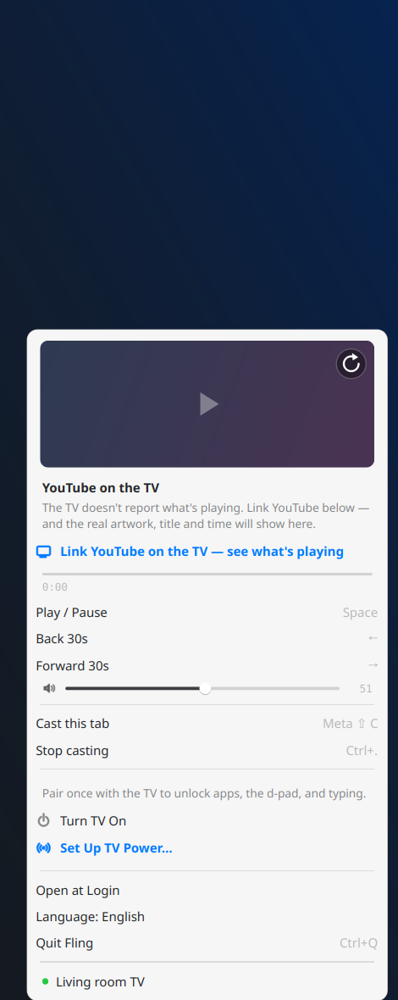
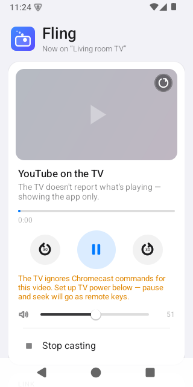

<div align="center">

# Fling for Linux & Android

**Your TV, from the KDE tray and from your phone.**

An **unofficial** Linux (KDE Plasma) and Android port of **[Fling](https://github.com/tatianathevisionary/fling)** —
the macOS menu-bar caster and TV remote created by
**[Damion Rashford](https://github.com/damionrashford)** and published by **[Tatiana](https://github.com/tatianathevisionary)**.
Cast a browser tab or a link to a Chromecast / Google TV — and drive the TV itself:
power, apps, d-pad, volume, typing, voice search.


&nbsp;&nbsp;


</div>

> **Authorship.** Fling — its idea, design, wording, app catalog and protocol work — belongs to
> **Damion Rashford** (author of the original code) and **Tatiana** (owner of the original repository).
> This repository is not their project and is not affiliated with or endorsed by them; it only
> brings their app to Linux and Android.
>
> **Status:** private preview. This is an independent re-implementation (Python/Qt and Java),
> not a fork: no Swift code was copied. The look, wording and app catalog follow the original
> Fling, whose repository has no license yet — the project stays private until its author agrees.
> See [CREDITS.md](CREDITS.md).

---

**Contents** · [Features](#features) · [How it works](#how-it-works) ·
[Install — Linux](#install--linux) · [Install — Android](#install--android) ·
[Connecting the TV](#connecting-the-tv) · [Usage](#usage) · [Troubleshooting](#troubleshooting) ·
[Privacy](#privacy) · [Project layout](#project-layout) · [Documentation](#documentation) · [Credits](#credits) · [License](#license)

## Features

| | Linux (KDE) | Android |
|---|:---:|:---:|
| Tray/panel UI modelled on the macOS Fling popover | ✓ | ✓ |
| Cast the current Firefox tab (global shortcut **Meta+Shift+C**) | ✓ | — |
| Cast a link from the clipboard / share sheet | ✓ | ✓ |
| Play / pause, ±30 s, volume, stop | ✓ | ✓ |
| **Real now-playing** (title, artist, artwork, time) via ADB | ✓ | ✓ |
| YouTube "Link with TV code" (live video + position) | ✓ | — |
| TV remote over the network: power, app launcher, d-pad, volume, typing, voice | ✓ | ✓ |
| Laptop as a **Bluetooth LE remote** (HID over GATT) | ✓ | — |
| One-click **Connect TV** window: find on LAN / pair remote / ADB / YouTube / Bluetooth | ✓ | — |
| Scroll / swipe anywhere = d-pad | ✓ | ✓ (touchpad) |
| Phone volume keys control the TV | — | ✓ |
| Quick Settings tile "Pause on TV" | — | ✓ |
| English / Russian UI (auto, switchable) | ✓ | ✓ |
| Terminal remote (`fling-tui`) | ✓ | — |
| TV screenshot over ADB (saved to Pictures/Fling) | ✓ | ✓ |

## How it works

Fling talks to the TV over several open protocols and uses whichever is available:

| Channel | Used for | Library / implementation |
|---|---|---|
| **Google Cast v2** (TLS :8009) | casting media, play/pause/seek/volume | [catt](https://github.com/skorokithakis/catt) on Linux; own Java client on Android |
| **Android TV Remote v2** (TLS :6466/:6467) | power, keys, app links, typing, voice | [androidtvremote2](https://github.com/tronikos/androidtvremote2) on Linux; own Java client on Android |
| **ADB over network** (:5555) | what is *really* playing (`dumpsys media_session`) | platform-tools `adb` on Linux; own Java ADB client on Android |
| **YouTube Lounge API** | exact video and position in the YouTube TV app | [pyytlounge](https://github.com/FabioGNR/pyytlounge) |
| **Bluetooth LE HID** | keys when the network remote isn't paired | BlueZ D-Bus (`linux/bt_remote.py`) |

Why so many? Native YouTube on Google TV reports a *frozen* Cast session (stuck in
`BUFFERING`, old artwork) and ignores Cast pause. Fling detects that, hides the stale data,
and routes control through the TV remote protocol, while ADB or YouTube Lounge provide the
real title, artwork and position.

## Install — Linux

Tested on Kubuntu 26.04 (KDE Plasma 6, Wayland). Other desktops with a system tray should work;
the global shortcut and blur are KDE-specific.

```sh
git clone https://github.com/orfixe/fling-linux-android.git && cd fling-linux-android/linux
./install.sh
fling            # opens the panel; the icon lives in the system tray
```

`install.sh` installs system packages (PyQt6, dbus, lz4, adb), [uv](https://docs.astral.sh/uv/),
catt, a private Python venv in `~/.local/share/fling`, launchers in `~/.local/bin`, menu entries,
and the **Meta+Shift+C** shortcut (active after re-login). Remove everything with
`./install.sh --uninstall`.

Commands:

```text
fling             open the panel (starts Fling if needed)
fling tray        start only the tray icon
fling setup       open the Connect TV window
fling screenshot  save a TV screenshot (needs ADB)
fling cast-tab    cast the current Firefox tab
fling clip        cast the link from the clipboard
fling quit        exit
fling tui         terminal remote
```

## Install — Android

Requires Android 8.0+. No Google Play Services, no Gradle: the app is plain Java built with the
SDK command-line tools.

```sh
cd android
./build.sh        # needs ANDROID_HOME (platform android-36, build-tools) and a JDK 17+
adb install -r Fling.apk
```

Or copy `Fling.apk` to the phone and open it (allow installing from that source).
Phone and TV must be on the same Wi-Fi.

## Connecting the TV

Open **Connect TV…** (panel, tray menu, or `fling setup`) and press **Find and connect everything**.
Each step shows ✓ done · ⏳ working · ! needs you on the TV · ✗ failed.

1. **Find TV on local network** — mDNS/Cast discovery; pick a device if you have several.
2. **TV remote (network)** — the TV shows a 6-character code; type it or click the on-screen
   0–9 / A–F keys (a Russian keyboard layout is translated automatically).
3. **ADB** — the TV asks *"Allow debugging?"*: choose **Always allow**. If ADB is off:
   *Settings → System → About → tap "Android TV OS build" 7×*, then
   *Settings → System → Developer options → USB debugging + Wireless debugging*.
   If the TV shows a pairing port and code, enter them in the window (`adb pair`).
4. **YouTube on the TV** *(optional)* — *YouTube → Settings → Link with TV code*, enter the 12 digits.
5. **Bluetooth remote** *(backup)* — on the TV: *Settings → Remotes & Accessories → Pair accessory →
   "Fling Remote"*. KDE asks you to confirm pairing.

## Usage

- **Panel:** click the tray icon. Space = play/pause, ←/→ = ±30 s, Ctrl+. = stop,
  scroll anywhere = d-pad, Esc = close. The ⟳ button on the artwork refreshes.
- **Cast this tab:** Fling reads the active Firefox tab from the session store. For instant
  pick-up set `browser.sessionstore.interval` to `2000` in `about:config`.
- **Android:** share a link to **Fling** from YouTube or a browser — it goes straight to the TV.
  Volume keys control the TV while the app is open. Add the *Pause on TV* Quick Settings tile.

What can be cast: YouTube (opened in the TV's YouTube app), direct media files
(mp4, mkv, webm, mp3, m3u8, mpd, …) and most sites [yt-dlp](https://github.com/yt-dlp/yt-dlp)
understands (Linux). DRM services (Netflix etc.) can be launched and controlled but not cast.

## Troubleshooting

| Symptom | Fix |
|---|---|
| Pause does nothing on YouTube | Pair the TV remote (Connect TV → step 2); Cast pause is ignored by native YouTube. |
| Old artwork / wrong title | That's the TV's frozen Cast session; connect ADB (step 3) for the real one. |
| "Not a video page" | Plain web pages can't be cast; open the video page itself. |
| Can't type the TV code | Use the on-screen keys under the field. |
| TV screenshot is black | DRM: video surfaces are protected; Fling uses media metadata instead. |
| Bluetooth remote not visible | Press *Connect as Bluetooth remote* again (the window lasts 3 min); check `bluetoothctl show` lists *Human Interface Device*. |
| Panel is tiny / blurry | Fling reads the XWayland scale from `~/.config/kwinrc`; set `QT_SCALE_FACTOR` to override. |

Logs: `~/.cache/fling/app.log`, `~/.cache/fling/bt.log`.

## Privacy

Everything stays on your network. Fling contacts only your TV, plus `youtube.com` for
titles/artwork lookups (oEmbed and search) and the YouTube Lounge API when you link it.
Pairing certificates live in `~/.local/share/fling/atv/` (Linux) or the app's private storage
(Android). No analytics, no accounts.

## Project layout

```text
linux/
  fling_app.py     tray + panel + Connect TV window (PyQt6)
  bt_remote.py     Bluetooth LE HID remote service (BlueZ D-Bus)
  sf_icons.py      line icons in SF-Symbols style
  fling            launcher (single instance, commands)
  fling-tui        terminal remote (bash + catt)
  install.sh       installer / uninstaller
android/
  src/app/fling/   MainActivity, Ui, Atv (TV remote), Cast (Cast v2), Adb (ADB client), Discovery (mDNS),
                   Proto (protobuf), Tls (self-signed client cert), L (i18n), PauseTile
  res/, AndroidManifest.xml, build.sh
docs/screenshots/
```

## Documentation

| Document | What it covers |
|---|---|
| [Architecture](docs/architecture.md) | Components, threading, now-playing sources, files |
| [Protocols](docs/protocols.md) | Cast v2, Android TV Remote v2, ADB, YouTube Lounge, Bluetooth LE HID |
| [Development](docs/development.md) | Building, checks, testing on a real TV, translations, releases |
| [Changelog](CHANGELOG.md) | What changed in each version |

## Credits

- **[Fling](https://github.com/tatianathevisionary/fling)** — the original macOS app, its idea,
  design, wording and protocol research. Created by **[Damion Rashford](https://github.com/damionrashford)**
  (author of the original code) and published by **[Tatiana](https://github.com/tatianathevisionary)**
  (repository owner). This port exists only because of their work.
- [catt](https://github.com/skorokithakis/catt) (BSD-2-Clause),
  [androidtvremote2](https://github.com/tronikos/androidtvremote2) (Apache-2.0),
  [pyytlounge](https://github.com/FabioGNR/pyytlounge) (MIT),
  [PyQt6](https://www.riverbankcomputing.com/software/pyqt/), BlueZ, Android platform-tools.

Details in [CREDITS.md](CREDITS.md).

## License

The code in this repository is [MIT](LICENSE). The original Fling — its design, texts and idea —
belongs to Damion Rashford and Tatiana; see [CREDITS.md](CREDITS.md).
