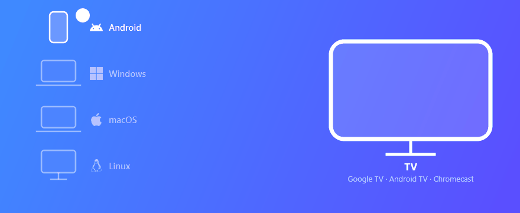
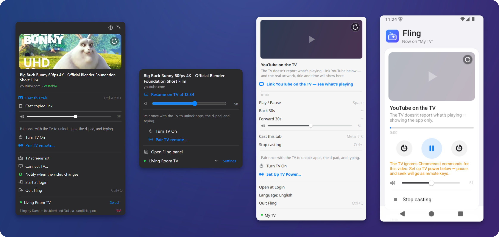
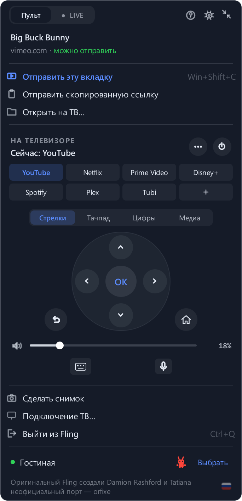
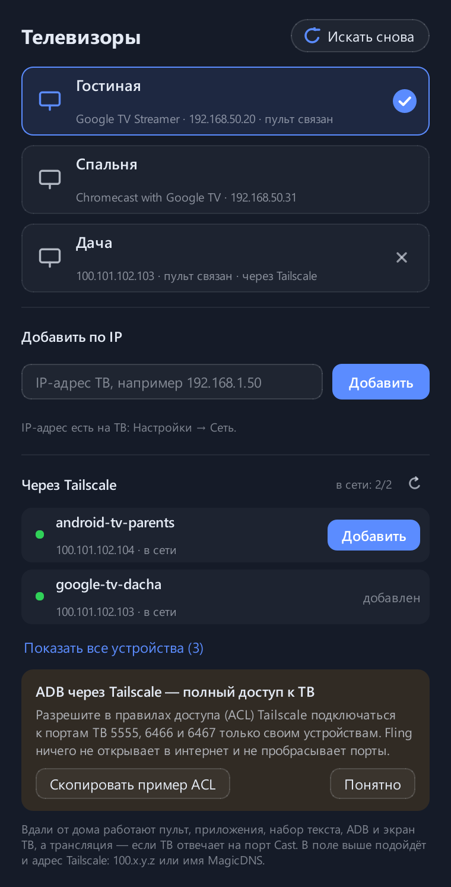
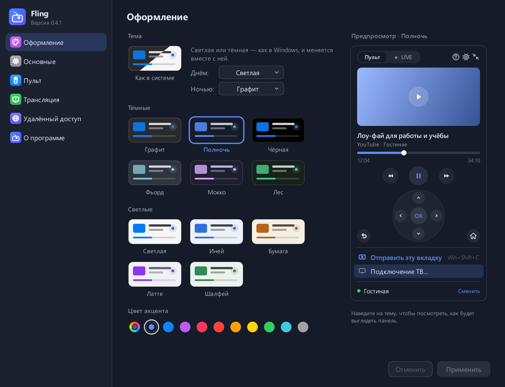
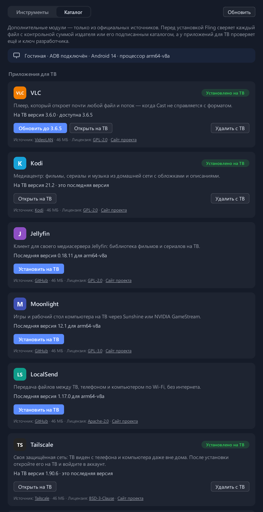
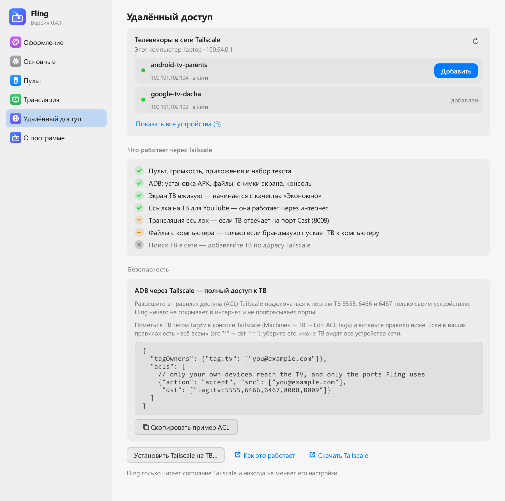

<p align="right">
  <a href="README.md">🇬🇧 English</a> &nbsp;·&nbsp; <a href="README.ru.md">🇷🇺 Русский</a>
</p>

<div align="center">


# Fling для Windows, Linux и Android

**Ваш телевизор — из трея Windows, панели KDE, браузера и телефона.**

Отправляйте вкладку браузера или ссылку на Chromecast / Google TV — и управляйте самим
телевизором: питание, приложения, громкость, ввод текста, голосовой поиск. **LIVE** показывает
экран ТВ на компьютере и телефоне (scrcpy), а через **Tailscale** всё это работает и вне дома.



[](docs/install-windows.ru.md)
[](#linux)
[](#android)
<br>
[](#расширение-для-браузера)
[](#расширение-для-браузера)
[](#расширение-для-браузера)
[](LICENSE)



<sub>Панель в Windows · расширение для браузера · KDE Plasma · Android</sub>

</div>

> [!WARNING]
> **Fling находится в стадии разработки.** От версии к версии многое меняется, а некоторые
> части ещё сырые (LIVE, ADB-консоль, сценарии, очереди и окно «Инструменты» — новые). Пишите о том, что не работает, в
> [Issues](https://github.com/orfixe/fling-port/issues).

> **Авторство.** Это **неофициальный** порт **[Fling](https://github.com/tatianathevisionary/fling)** —
> приложения для macOS, созданного **[Damion Rashford](https://github.com/damionrashford)** (автор кода)
> и опубликованного **[Tatiana](https://github.com/tatianathevisionary)**. Идея, дизайн, тексты,
> каталог приложений и работа с протоколами принадлежат им. Этот репозиторий не их проект и не
> связан с ними; он только переносит их приложение на Windows, Linux, Android и в браузер.
> Код для Windows, Linux, Android и браузера написан заново (Python/Qt, Java, JavaScript),
> Swift-код не копировался. Сборка для macOS — это оригинальное приложение на Swift с небольшими
> изменениями, по лицензии оригинала (Boost Software License 1.0). Подробнее — [CREDITS.md](CREDITS.md).

---

## Быстрый старт

| У меня… | Что сделать |
|---|---|
| **Windows 10 / 11** | Скачайте `Fling-Setup-….exe` со страницы [Releases](../../releases), при желании [проверьте подлинность файла](SECURITY.md#is-my-copy-the-real-fling) и запустите. Подробно: **[гайд для Windows](docs/install-windows.ru.md)** |
| **Chrome / Edge / Firefox / Safari** | Сначала поставьте приложение, затем [расширение](#расширение-для-браузера) |
| **Linux** | Скачайте `Fling-Setup-…-linux.run` в [Releases](../../releases) и откройте — [подробнее](#linux) |
| **Телефон на Android** | Поставьте `Fling.apk` со страницы [Releases](../../releases) — [подробнее](#android) |

Компьютер / телефон и телевизор должны быть в одной сети.

**Проверено на:** Windows 11 с Edge и Chrome, Kubuntu 26.04 (KDE Plasma 6), Android 17,
телевизор с Google TV. Расширение для Firefox и Safari собрано, но ещё не проверялось —
будем рады отзывам.

## Возможности

| | Windows | Linux (KDE) | Android | Расширение |
|---|:---:|:---:|:---:|:---:|
| Панель в стиле оригинального Fling | ✓ | ✓ | ✓ | ✓ окошко |
| Отправить текущую вкладку | ✓ **Win+Shift+C** | ✓ **Meta+Shift+C** | — | ✓ **Alt+Shift+C** |
| Продолжить на ТВ с того же места | ✓ ¹ | ✓ ¹ | — | ✓ |
| Ссылка из буфера / «Поделиться» / меню правой кнопки | ✓ | ✓ | ✓ | ✓ |
| Пауза, ±30 с, громкость, стоп | ✓ | ✓ | ✓ | ✓ |
| **Настоящее «что играет»** (название, обложка, время) через ADB | ✓ | ✓ | ✓ | ✓ |
| Уведомление о смене видео / трека (отключается) | ✓ | ✓ | — | — |
| YouTube «Связать с ТВ по коду» | ✓ | ✓ | — | — |
| Пульт: питание, приложения, стрелки, громкость, ввод текста | ✓ | ✓ | ✓ | ✓ |
| Голосовой поиск через микрофон | ✓ | ✓ | ✓ | — |
| Ноутбук как **Bluetooth-пульт** | — ² | ✓ | — | — |
| Окно «Подключение ТВ» в один клик | ✓ | ✓ | — | — |
| Стрелки колёсиком мыши или свайпом | ✓ | ✓ | ✓ | ✓ |
| Громкость кнопками телефона, плитка в быстрых настройках | — | — | ✓ | — |
| Режимы пульта (тачпад, цифры, медиаклавиши), избранные приложения, сценарии | ✓ | ✓ | — | ✓ |
| Таймер сна для ТВ | ✓ | ✓ | ✓ | ✓ |
| Очередь, плейлисты (m3u / pls), слайд-шоу из фото, субтитры, продолжение просмотра | ✓ | ✓ | очередь ³ | — |
| Фото, видео и музыка с телефона («Поделиться» → «На телевизор») | — | — | ✓ | — |
| Уведомление с кнопками управления, в том числе на экране блокировки | — | — | ✓ | — |
| Настройки с темами и предпросмотром | ✓ 11 тем | ✓ 11 тем | ✓ и Material You | ✓ параметры |
| **LIVE** — экран ТВ с мышью и клавиатурой (scrcpy) | ✓ в панели | ✓ окно scrcpy | ✓ новое ⁴ | — |
| Удалённый доступ через **Tailscale** (пульт, ADB, LIVE вне дома) | ✓ | ✓ | ✓ | — |
| **Smart View**: телевизоры Samsung (пульт, приложения, DLNA) и зеркалирование экрана по Miracast, в том числе по Wi‑Fi Direct без общей сети | ✓ новое ⁵ | ✓ зеркалирование через GNOME Network Displays ⁵ | ✓ Samsung; зеркалирование через системную «Трансляцию» ⁵ | — |
| Приветствие при первом запуске: язык, затем короткий анимированный тур (можно пропустить) | ✓ | ✓ | ✓ язык + подсказки | — |
| Окно **«Инструменты»**: найти, установить и обновить adb / scrcpy | ✓ | ✓ | — | — |
| **Каталог**: официальные приложения для ТВ (VLC, Kodi, Jellyfin, Moonlight, Tailscale…) с проверкой перед установкой | ✓ | ✓ | — | — |
| Подписанные релизы, защита от посторонних процессов | ✓ | — | — | — |
| Английский / русский интерфейс | ✓ | ✓ | ✓ | ✓ |
| Снимок экрана ТВ через ADB | ✓ | ✓ | ✓ | — |
| Установка APK на ТВ через ADB (выбрать файл или правый клик по нему в Проводнике) | ✓ | ✓ | — | — |

<sub>¹ когда вкладку отправляет расширение. ² Windows не позволяет программам быть Bluetooth-клавиатурой / пультом.
³ несколько отправленных файлов играют друг за другом. ⁴ новое в 0.4.1, пока проверено на немногих устройствах.
⁵ новое в 0.5.0, подробнее — [docs/smart-view.ru.md](docs/smart-view.ru.md). Зеркалирование по Wi‑Fi Direct проверено
на гостиничном ТВ Samsung; сетевой пульт Samsung и DLNA — на имитаторе протокола, на настоящем ТВ ещё нет.</sub>

Не отправляете вкладки браузера? Нажмите **«Скрыть»** под подсказкой про расширение в панели — вернуть можно
в «Настройки → Основные → Отправка вкладок браузера».

### Скриншоты

| | |
|:---:|:---:|
|  |  |
| Панель: трансляция, режимы пульта, избранные приложения | Выбор ТВ: поиск, карточки, ТВ через Tailscale |
|  |  |
| Настройки: 11 тем с живым предпросмотром | Каталог: официальные приложения для ТВ с проверкой перед установкой |
|  | |
| Удалённый доступ через Tailscale: что работает вне дома | |

**LIVE** показывает собственный экран ТВ: в Windows прямо в панели (щёлкните по картинке — и мышь с клавиатурой управляют ТВ), а с версии 0.4.1 и на телефоне: Fling для Android запускает на ТВ официальный сервер scrcpy и аппаратно декодирует картинку с низкой задержкой — дома или через Tailscale.

## Windows

**→ Подробный пошаговый гайд: [docs/install-windows.ru.md](docs/install-windows.ru.md).**

- **Установщик:** **`Fling-Setup-….exe`** со страницы [Releases](../../releases) → запустить.
  Ставится только для вашего пользователя, без прав администратора: ярлык в «Пуске», команда `fling`,
  по желанию автозапуск; удаление — «Параметры → Приложения». Python ставить не нужно, scrcpy уже внутри.
  SmartScreen может предупредить о неподписанной программе: *Подробнее → Выполнить в любом случае*.
- **Проверка подлинности:** к каждому релизу приложен `SHA256SUMS.txt`, подписанный ключом
  релизов Fling. Как проверить файл в любой ОС — в [SECURITY.md](SECURITY.md#is-my-copy-the-real-fling)
  (на английском). После установки за файлами Fling следит `fling-guard`: он сверяет их с этим
  подписанным списком.
- **Из исходников:** **`windows\install.cmd`** (удаление — `windows\uninstall.cmd`).

При первом запуске разрешите Fling доступ к **частным сетям** в окне брандмауэра.

## Расширение для браузера

Одно расширение для **Chrome, Edge, Яндекс Браузера, Brave, Opera, Vivaldi, Firefox и Safari**:
окошко с кнопкой «Отправить эту вкладку» (или **«Продолжить на ТВ с 12:34»**, если видео уже идёт),
что играет, пауза/перемотка, громкость, полный пульт и недавние трансляции; пункты в меню правой
кнопки, в том числе «Отправить с этого момента»; метки времени в ссылках YouTube, Twitch и Vimeo
учитываются; **Alt+Shift+C** и сочетания клавиш, которые можно назначить самому (пауза, ±30 с, громкость).
Расширение общается **только** с приложением Fling на этом же компьютере (127.0.0.1).

| Браузер | Установка |
|---|---|
| Chrome, Edge, Яндекс, Brave, Opera, Vivaldi | страница расширений → «Режим разработчика» → **«Загрузить распакованное»** → папка `extension\chrome` |
| Firefox | `about:debugging` → **«Загрузить временное дополнение»** → `fling-firefox-….zip` |
| Safari (Mac) | `extension/safari/build-safari.sh` на Mac с Xcode; нужен Fling на этом же Mac (пока не проверялось) |

Подробно — в [гайде, часть 2](docs/install-windows.ru.md#часть-2-расширение-для-браузера).

## Linux

1. Скачайте **`Fling-Setup-<версия>-linux.run`** в [Releases](../../releases)
   (при желании [проверьте](SECURITY.md#is-my-copy-the-real-fling): он есть в подписанном `SHA256SUMS.txt`).
2. Откройте его: в Dolphin / «Файлах» разрешите запуск (*Свойства → Права → Исполняемый*) и
   щёлкните дважды, или в терминале: `bash Fling-Setup-*-linux.run`.
3. Запустите **Fling** из меню приложений. Значок появится в системном трее.

Установщик ставит Fling только для вашего пользователя и **не требует root**: всё идёт в `~/.local`.
Что уже есть в системе, используется; чего нет — берётся из официальных источников (PyQt6 и lz4
с PyPI, adb от Google, scrcpy из его релизов на GitHub, с проверкой контрольных сумм). На Debian/Ubuntu,
Arch, Fedora и openSUSE он сначала предложит недостающие системные пакеты (спросит пароль; можно
отказаться или передать `--no-system` — из системы нужны только D-Bus / PyGObject для уведомлений KDE
и Bluetooth-пульта).

Обновление — запустить более новый `.run` (запущенный Fling перезапустится). Удаление:
`bash Fling-Setup-*-linux.run --uninstall`; `--extract ПАПКА` только распакует файлы.

Из исходников: `git clone https://github.com/orfixe/fling-port.git && fling-port/linux/install.sh`.
Собрать `.run` из своей копии: `linux/make-run.sh` (→ `dist/`).

Проверено на Kubuntu 26.04 и CachyOS (KDE Plasma 6). Подробности — в [английском README](README.md#install--linux).

### Команды

Одинаковы в Linux и Windows (в PowerShell / cmd):

```text
fling                 открыть панель (и запустить Fling, если нужно)
fling setup           окно «Подключение ТВ»
fling settings        настройки (темы, пульт, трансляция)
fling about           настройки → «О программе»
fling tools           найти, установить или обновить adb и scrcpy
fling help            встроенная инструкция
fling cast-tab        отправить текущую вкладку браузера
fling clip            отправить ссылку из буфера обмена
fling send файл…      на ТВ: APK устанавливаются, медиа играют, остальное — в папку Download
fling play [файл|папка|плейлист|ссылка…]   играть на ТВ по очереди (без аргументов — выбрать файлы)
fling slideshow [папка] [секунды]          слайд-шоу из фото (по умолчанию 7 с на фото)
fling next / fling prev                    следующий / предыдущий элемент очереди
fling scene "Название"                     запустить сценарий (например, из Планировщика заданий)
fling sleep-timer N                        выключить ТВ через N минут
fling tv-on / fling tv-off                 включить / выключить ТВ
fling screenshot      снимок экрана ТВ (нужен ADB)
fling quit            выйти
```

## Android

Android 8.0+. Скачайте `Fling.apk` со страницы [Releases](../../releases) и откройте на телефоне
(разрешите установку из этого источника), или соберите: `cd android && ./build.sh`.

Ссылки, фото, видео и музыку отправляйте через «Поделиться» → **«На телевизор»**: несколько файлов
сыграют друг за другом. Пока что-то играет, в уведомлении и на экране блокировки есть кнопки
управления, а кнопки громкости телефона меняют громкость ТВ. В настройках (шестерёнка в заголовке) —
тема и цвет акцента (на Android 12+ — Material You, по цветам обоев). Таймер сна — в пульте.

## Подключение ТВ

**«Подключение ТВ…»** → **«Найти и подключить всё»**: поиск ТВ в сети, пульт по коду с экрана,
ADB («Разрешить отладку?» → «Всегда»), по желанию YouTube по коду и Bluetooth-пульт (Linux).
Подробно — в [гайде](docs/install-windows.ru.md#подключить-пульт-один-раз) и
[английском README](README.md#connecting-the-tv).

## Приватность

Всё происходит в вашей сети. Fling обращается только к телевизору и к youtube.com (названия и
обложки). Только по вашей просьбе он проверяет новую версию на GitHub («Настройки → О программе»)
и скачивает adb / scrcpy у Google и с GitHub (окно «Инструменты»). Расширение передаёт адрес вкладки только приложению Fling на этом же компьютере и никогда
— из приватных окон. Ни аналитики, ни аккаунтов.

## Документация

| Документ | О чём |
|---|---|
| [Гайд для Windows](docs/install-windows.ru.md) · [EN](docs/install-windows.md) | Приложение, расширение, первый запуск, проблемы |
| [Удалённый доступ через Tailscale](docs/tailscale.ru.md) · [EN](docs/tailscale.md) | Управление ТВ вне дома: настройка, правила доступа (ACL), что работает удалённо |
| [Smart View — Samsung и Miracast](docs/smart-view.ru.md) · [EN](docs/smart-view.md) | Зеркалирование экрана (и в отеле по Wi‑Fi Direct), пульт Samsung, DLNA, разрешение |
| [Architecture](docs/architecture.md) · [Protocols](docs/protocols.md) · [Development](docs/development.md) | Для разработчиков (англ.) |
| [Changelog](CHANGELOG.md) | Изменения по версиям |

## Лицензия

Код этого порта — [MIT](LICENSE), © 2026 orfixe и участники порта Fling. Оригинальный Fling — его
дизайн, тексты и идея — принадлежит Damion Rashford и Tatiana, см. [NOTICE](NOTICE) и
[CREDITS.md](CREDITS.md). Сборка для Windows включает сторонние программы со своими лицензиями —
PyQt6 (GPL-3.0; полный исходный код — этот репозиторий), scrcpy (Apache-2.0) и другие:
[THIRD-PARTY-NOTICES.md](THIRD-PARTY-NOTICES.md). Распространяя порт, сохраняйте эти файлы и строку
об авторстве в приложении.
